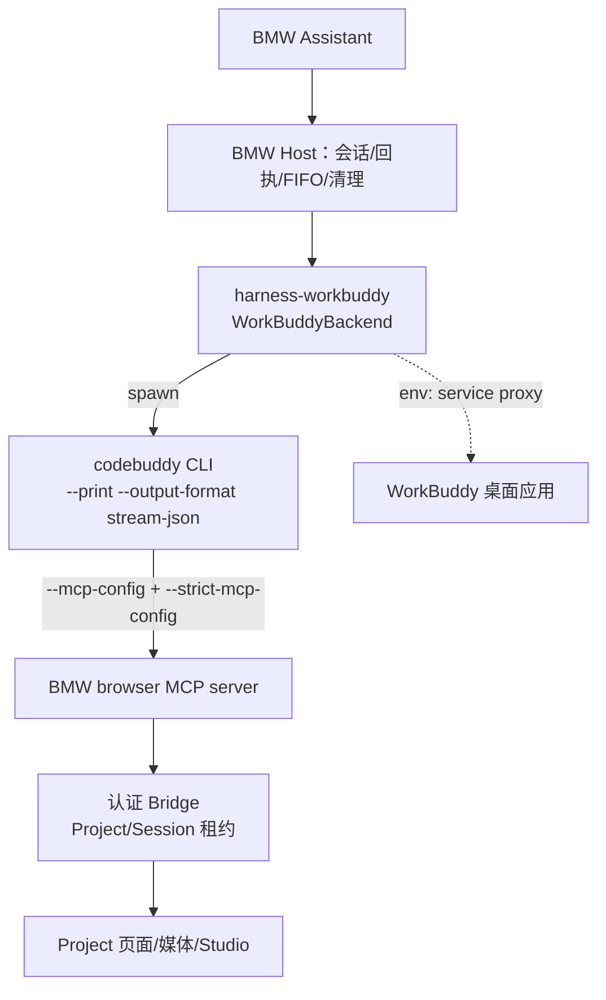

# WorkBuddy 作为 BMW 第四驱动 · 设计方案（待确认）

> 2026-10-22 合并旧分支后归档。以下保留原研究及当时状态，含已推翻结论；不是当前待办或授权。现行四驱动边界见[驱动架构](../../AGENT_DRIVER_DESIGN.md)，当前实现见[功能规格](../../FUNCTIONAL_SPEC.md)。文内代码样式路径按原仓库根解释，同行路线比较现为 [WORKBUDDY_DRIVER_COMPARISON.md](WORKBUDDY_DRIVER_COMPARISON.md)。

> ⚠️ **§0 与 §0.1 的结论已被官方文档调研推翻，请以 `docs/plans/WORKBUDDY_DRIVER_COMPARISON.md` 为准。**
> 初版把"CLI 静默挂住"归因为"缺主进程 broker、外部进程无法运行"，这是错的。真因是①本地控制端口与 WorkBuddy 桌面进程冲突、②继承了会话级 `CODEBUDDY_*` agent 环境变量。
> 官方另有 3 类独立认证（API Key / Auth Token / SDK `authenticate()`），ACP 也已实测握手成功。本文 §4 起的包清单、三层工具边界、失败模式、验证计划仍然有效，只需替换传输层与认证层。

状态：草案，未实现。仅分析与设计，不含代码改动。
日期：2026-10-19。基 commit：`7d4a294`。

## 0. 一句话结论

技术上可做，且 BMW 的驱动契约与 WorkBuddy 的运行时长得很像；**唯一硬缺口是 WorkBuddy 的 Agent 运行时没有独立登录**——它被设计成由 WorkBuddy 桌面应用注入本地服务代理后启动，独立进程跑会静默挂住。因此第四驱动能不能"干净地"落地，取决于认证策略怎么选，而不是取决于写多少代码。

## 0.1 M0 可行性实测结论（2026-10-19，**阻塞项**）

已确认选择的 **A1「继承环境变量借壳」不可行**，证据三条：

| # | 实测 | 结论 |
|---|---|---|
| 1 | 继承本会话全部 `CODEBUDDY_*` / proxy 变量跑 `codebuddy -p` | 启动即 `setProxy` 崩溃（`Right-hand side of 'instanceof' is not callable`），随后无输出静默挂住 |
| 2 | 清掉 `HTTP(S)_PROXY` 再跑 | 崩溃消失，但 `Config.fetchConfig` 无响应，仍静默挂住（>15 分钟无终态） |
| 3 | 查启动链路 | CLI 不是裸进程：`cli/vendor/shim/brokered-bin/codebuddy-toybox-dispatch` 要求 `CODEBUDDY_SANDBOX_BROKER_IPC_ADDRESS` + `CODEBUDDY_SANDBOX_BROKER_SESSION_ID` 等活着的 broker IPC 会话，该 broker 由 WorkBuddy 主进程持有；外层还有 `vendor/toybox-macos` 沙箱 |

即：WorkBuddy 的 Agent 运行时是**被主进程托管的沙箱子进程**，模型调用、远端配置、文件删除都经 broker 代理。**外部进程无法只靠环境变量复刻**——缺的是主进程里的 broker 与网关，不是几个变量值。

因此 A1 需要降级判断：

| 变体 | 做法 | 可行性 |
|---|---|---|
| A1a 继承 env | 已实测 | ❌ 不可行 |
| A1b 走官方 dispatcher | 用 `codebuddy-toybox-dispatch` + 伪造 broker IPC | ❌ 需伪造 broker 会话，属于逆向内部协议，版本一升即碎，且违反"不读原生桌面私有凭据/通道" |
| A2 受控端口 | 由 BMW 连接 WorkBuddy 已开的本地网关 | ⚠️ 未见公开的 agent 入口；网关是内部 hook 端点，不是稳定的 Agent API |
| A3 官方独立认证/ACP | 等 WorkBuddy 提供 `login` 或对外 ACP/HTTP Agent 接口 | ✅ 唯一干净路径，当前 blocked |

**建议**：不要按 A1 继续写 harness。改为「先按 A3 的口径把适配层骨架和契约测试写好（认证/传输可插拔），等官方接口到位通电」；或者在确认允许逆向的前提下再做 A1b 的 POC（不建议进主干）。

## 1. 调研证据（本机实测）

### 1.1 WorkBuddy 的官方运行时

`/Applications/WorkBuddy.app/Contents/Resources/app.asar.unpacked/cli/` 内置 `@genie/agent-cli`（bin: `codebuddy` / `cbc`），实测 `--help` 具备以下能力：

| BMW 需要的能力 | CLI 对应参数 | 是否具备 |
|---|---|---|
| 非交互执行 | `-p/--print` | ✅ |
| 流式事件 | `--output-format stream-json`、`--include-partial-messages` | ✅ |
| 结构化输入 | `--input-format stream-json` | ✅ |
| 只暴露一个 MCP 工具 | `--mcp-config <json>` + `--strict-mcp-config` | ✅ |
| 禁用所有内置工具 | `--tools ""` | ✅ |
| 工具白名单 | `--allowedTools` / `--disallowedTools` | ✅ |
| 续聊 | `--resume <sessionId>`、`-c`、`--fork-session` | ✅ |
| 固定会话 ID | `--session-id <uuid>` | ✅ |
| 模型选择 | `--model`，列表含 `deepseek-v4.1-flash`、`deepseek-v4-pro` 等 | ✅ |
| 结构化控制协议 | `--acp`（Agent Client Protocol / stdio ndJson） | ✅（协议层可用） |
| 权限模式 | `--permission-mode` | ✅ |

结论：**能力面与 Qoder SDK / Codex App Server 同构**，BMW 现有的 `browser-only` 边界（`--tools ""` + `--strict-mcp-config` 只挂 BMW Bridge）在参数层可以被强制，不需要模型配合。

### 1.2 硬缺口：没有独立认证

实测三件事：

| 测试 | 结果 |
|---|---|
| `codebuddy --help` / `config --help` | 能出用法，但启动即 `fetch config failed TypeError: Right-hand side of 'instanceof' is not callable`（`setProxy` 内） |
| `codebuddy -p "…" --output-format json --tools "" --model deepseek-v4.1-flash` | **无输出、静默挂住**（>2 分钟，stdout/stderr 均空） |
| `codebuddy --acp` + `initialize` 握手 | **无响应**，stderr 为空 |

对照 WorkBuddy 会话内实际存在的环境变量：

```
CODEBUDDY_SERVICE_PROXY_URL=http://127.0.0.1:63533/internal/hooks/services/invoke
WORKBUDDY_PROXY_SOURCE=system
CODEBUDDY_MCP_CONFIG={...connector-proxy / agent-mail / genie-baas / space-library ...}
HTTP_PROXY/HTTPS_PROXY=http://127.0.0.1:63559     # 会话级代理
```

即：**模型调用与远端配置都走 WorkBuddy 桌面应用提供的本地服务代理**，CLI 自身不带账号/密钥；`--help` 里没有 `login`，dist 里也找不到 API Key 入口，`~/.codebuddy` 下只有 `settings.json`（含本地网关口令）和 `user-state.json`（无账号令牌）。

这一条直接撞上现有产品契约：

> 各驱动使用独立配置和官方正常登录流程，不读取原生桌面的私有凭据。 — `docs/AGENT_DRIVER_DESIGN.md`

## 2. 三条路线

| 路线 | 做法 | 认证 | 优点 | 缺点 | 结论 |
|---|---|---|---|---|---|
| **A. 子进程 + 复用本机 WorkBuddy 登录** | BMW spawn `codebuddy -p --output-format stream-json …`，注入 WorkBuddy 桌面应用的 service-proxy 环境 | 借 WorkBuddy 桌面已登录会话 | 实现最快（1 个 harness 包），与三家同构 | **M0 实测已证伪**：缺主进程 broker，裸进程静默挂住（见 0.1） | ❌ 不可行 |
| **B. ACP 结构化接入** | 同上，但走 `--acp` JSON-RPC：`session/new`、`session/prompt`、`session/update`、`session/cancel` | 同 A | 事件语义比 stream-json 干净得多，取消/审批有一等公民 | 需先验证 ACP 方法集与本机版本；认证前提不变 | 作为 A 的二期升级 |
| **C. 等官方独立认证** | 要一个可独立 `login`（API Key / OAuth）的 WorkBuddy CLI | 官方独立 | 完全合规、不依赖桌面 | 现在没有；blocked | 若 A 的借壳不可接受，只能选 C |

我的建议：**先按 A 落地，但把认证抽象成可替换的一层**，等官方 CLI 具备独立登录时切到 C 不需改业务代码。

## 3. 方案 A 架构



与现有三驱动的同构对照：

| 维度 | DSH | Codex | Qoder CN | WorkBuddy（新增） |
|---|---|---|---|---|
| 传输 | 官方 CLI + 本地 JSON 行 | App Server JSON-RPC | 官方 SDK `query()` | 官方 CLI `-p` + stream-json |
| 会话锚点 | DSH session id | thread id | session_id | `--session-id` / `--resume` |
| 工具边界 | preset 只装 browser | dynamicTools 只给 browser | `tools:[]` + `allowedTools:['browser']` + `strictMcpConfig` | `--tools ""` + `--strict-mcp-config` |
| 取消 | 官方 interrupt | `turn/interrupt` | `query.interrupt()` | 进程 SIGTERM + `--input-format stream-json` 关闭，超时后 kill |
| 配置隔离 | `dsh-home` | `agent-drivers/codex` | `agent-drivers/qoder-cn` | `agent-drivers/workbuddy` |

## 4. 包与文件清单

新增 `packages/harness-workbuddy`（包名 `@bmw-agent/harness-workbuddy`，driverId `workbuddy`）：

| 文件 | 职责 | 预估 |
|---|---|---|
| `src/workbuddy-backend.ts` | `AgentBackend` 实现：spawn/握手/事件循环/取消/清理 | ~280 行 |
| `src/workbuddy-events.ts` | stream-json → `AgentDriverEvent` 归一化，含 `browser` 工具事件与终态判定 | ~130 行 |
| `src/workbuddy-launch.ts` | CLI 发现（`BMW_WORKBUDDY_EXECUTABLE` → 应用内 CLI → PATH）、版本白名单、环境构造 | ~90 行 |
| `src/workbuddy-settings.ts` | `AgentDriverSettings`：认证状态、模型 allowlist、模型选择持久化 | ~110 行 |
| `src/workbuddy-guidance.ts` | BMW Assistant 系统提示片段（对齐 qoder `bmw-guidance`） | ~10 行 |
| `src/index.ts` + `package.json` | 公开出口（只导出 backend/settings） | ~15 行 |
| `test/workbuddy-events.test.ts` | 事件映射单测（含越界工具拒绝） | ~150 行 |
| `test/workbuddy-backend.test.ts` | 假 CLI 夹具：握手、续聊、取消、事件后置拒绝 | ~200 行 |

需要改动的既有位置（我逐个 grep 确认过）：

| 位置 | 改动 |
|---|---|
| `apps/bmw/agent-assembly.ts` | `defaultDriverId` 联合类型加 `'workbuddy'`；`createBackends` 追加 `new WorkbuddyBackend(...)`；profile 独立目录校验 |
| `package.json` / workspaces | 无需改（`packages/*` 已覆盖） |
| `scripts/assistant-default-case.ts:52` | 驱动 id 断言 `['dsh','codex','qoder-cn']` → 加 `'workbuddy'` |
| `scripts/native-assistant-case.ts:22`、`scripts/test-catalog.ts:143` | 驱动白名单/目录分类补 `workbuddy` |
| `docs/AGENT_DRIVER_DESIGN.md` | "WorkBuddy 暂不纳入" → 改为第四驱动，补责任与验收 |
| `docs/ARCHITECTURE.md` | `npm run docs:architecture` 重新生成模块清单（12 → 13 模块） |
| `docs/FUNCTIONAL_SPEC.md` | `npm run docs:features` 重生成；补 WorkBuddy 设置/边界条款 |
| `README.md`、`handoff.md`、`docs/PROJECT_STATUS.md` | 驱动列表与运行前提（需 WorkBuddy 桌面在跑） |

## 5. 契约映射

`AgentBackend`：

| 方法 | 实现要点 |
|---|---|
| `description` | `{id:'workbuddy', label:'WorkBuddy', baseline:'agent-cli <ver> / stream-json', capabilities:{streaming:true, images:false*, interrupt:true, steer:false, fork:false, approvals:false, nativeOpen:false, browserOnly:false}}`（*images 先 false，验证 CLI 支持图像输入后再开） |
| `prepare()` | 校验 CLI 存在与版本准入 → 建独立 config dir → 起进程 → 读到 `system/init` 确认 **工具目录恰好只有 `browser`** → 才返回 `browserOnly:true` |
| `run()` | 先 `session.bound`（回填 session id）→ 投递 prompt → `input.accepted` → 消费事件直到终态 |
| `interrupt()` | 关闭 stdin → 等待进程退出 → 超时 SIGTERM → 再超时 SIGKILL；无论成败都走 `drain` |
| `respond()` | 抛错（不启用 approvals，权限由 BMW Bridge 控制） |
| `drain()` | 只重试原生清理，绝不重投输入 |
| `settings()` | `refresh`：探测 CLI + 认证状态 + 模型目录；`model.select`：写 BMW Profile；`auth.login`：**仅返回"复用 WorkBuddy 登录"的说明或提示用户去 WorkBuddy 登录**（不接收密码） |

`AgentDriverEvent` 映射（stream-json 侧）：

| CLI 事件 | BMW 事件 |
|---|---|
| `system/init`（`session_id` + 工具目录） | 不直接外发；用于 `session.bound` 与边界校验 |
| `assistant` 文本增量 / `stream_event` | `message.delta` |
| `assistant` 完整消息 | `message.completed`（校验前缀一致） |
| `tool_use name=mcp__bmw__browser` | `tool.started{name:'browser', action}` |
| `tool_result` | `tool.completed{success, message}` |
| 任何其他 `tool_use` | **抛错终止本轮**（越界即失败，不降级） |
| `result{is_error:false}` | `turn.completed{outcome:'success'}` |
| `result{is_error:true}` | `turn.completed{outcome:'failed'}` |
| 进程异常退出/无终态 | `turn.disconnected`，run 判 `uncertain`，不自动重发 |

## 6. 工具边界（三层，缺一不可）

1. **参数层**：`--tools ""` 清空内置工具；`--strict-mcp-config` 使 `--mcp-config` 成为唯一 MCP 来源；MCP 配置里只挂 `bmw` 一个 stdio server。
2. **运行层**：进程环境里塞 `BMW_BRIDGE_URL/BMW_BRIDGE_TOKEN/BMW_SESSION_BINDING`（与 qoder 完全一致），Bridge 侧按租约校验 Project/Session 归属。
3. **校验层**：`prepare()` 必须读到实际 init 工具目录且 == `{browser}`，否则不放行输入；运行中收到非 `browser` 工具调用直接终止本轮。

## 7. 认证与配置隔离（**核心决策点**）

三个子方案，需要你选一个：

| 子方案 | 做法 | 合规性 | 风险 |
|---|---|---|---|
| **A1 借壳（推荐起步）** | BMW 拉起 CLI 时继承 WorkBuddy 桌面应用注入的 service-proxy 环境；要求 WorkBuddy 正在运行且已登录 | 与现有契约"不读桌面私有凭据"冲突，需你显式豁免 | WorkBuddy 未启动/登出则驱动不可用；环境变量名与端口是内部契约，版本升级可能变 |
| **A2 受控代理端口** | 只复用 `CODEBUDDY_SERVICE_PROXY_URL` 与 gateways 口令，由 BMW 在设置面板显式采集一次并存加密凭据 | 折中：BMW 自己存凭据，但凭据来自 WorkBuddy 侧 | 仍需 WorkBuddy 在场；口令会过期 |
| **A3 官方独立认证（理想）** | 要求 WorkBuddy 提供 `codebuddy login` / API Key | 完全合规 | 现在不存在，需等官方 |

配置隔离一致做法：`userDataDirectory/agent-drivers/workbuddy` 作为独立 CLI 配置目录（`HOME`/`CODEBUDDY_CONFIG_DIR` 视实测结果二选一），首次初始化时从用户既有 `~/.codebuddy` 只读复制，后续不改原文件——与 DSH 导入凭据的方式一致。

## 8. 设置面板与模型准入

- 认证状态：`ready`（检测到 WorkBuddy 登录 + 代理可用）/ `required`（提示"请先登录 WorkBuddy 桌面应用后刷新"）/ `unknown`。
- 模型：维护白名单，**只列官方目录 ∩ 白名单**。起步白名单建议：`deepseek-v4.1-flash`（便宜、快）、`deepseek-v4-pro`、`glm-5.3`。目录里出现未知型号**不自动准入**（对齐 Codex 的做法）。
- 登录方式：A1/A3 下不提供密码表单，只提供"打开 WorkBuddy / 重新刷新"。

## 9. 失败模式与会话语义

- **不确定投递**：已写回执但进程在终态前崩溃 → `disconnected`，不自动重发，需用户显式继续。
- **取消竞态**：取消发生在投递前/投递后分别处理，只发一次终止，不重复投递。
- **续聊**：首轮从 `system/init` 抓 `session_id` 存为 `externalSessionId`；次轮 `--resume <id>`；返回 id 不一致即拒。
- **跨 Project**：Bridge 租约绑定 Project，`drain` 不解除隔离直到清理成功。

## 10. 验证计划

| 层级 | 内容 |
|---|---|
| 单测 | 事件映射、越界工具拒绝、终态唯一性、事件晚到拒绝 |
| 契约/边界 | `description` 能力位、`package.json` 出口、依赖方向（不引 apps） |
| 假 CLI 运行时 | 夹具模拟 init/prompt/tool/result，覆盖续聊、取消、崩溃 |
| 真实连通 | 一次 `browser` tabs.list 往返 + 截图读图（付费模型，单列证据，不计入离线） |
| 桌面 e2e | 四驱动切换、模型选择、跨会话保留、重启续聊 |
| 回归 | `npm run build` / `check` / `test` / `test:boundaries` / `test:dsh-e2e`（确认三家不受影响） |

## 11. 里程碑

| 阶段 | 产出 | 依赖 |
|---|---|---|
| M0 | 认证可行性实测 → **已执行，A1 证伪**（见 0.1） | — |
| M1 | 官方认证入口就位后：拉起 CLI + init 目录校验通过（证明工具目录只有 browser） | 官方 login/ACP 或 A1b POC |
| M2 | 事件归一化 + 单测/契约测试全绿 | M1 |
| M3 | 装配第 4 驱动 + 设置面板 + 门禁脚本/文档更新 | M2 |
| M4 | 真实往返验收 + 续聊/取消/跨 Project 证据归档 | M3 |

代码量预估：harness 包 ~630 行（含测试），装配与门禁改动 ~60 行，文档 4 处。核心不确定性在 M1（认证与 broker 链路），不在写码量。

## 12. 主要风险

1. **内部契约风险**：`CODEBUDDY_SERVICE_PROXY_URL` 等属 WorkBuddy 内部实现，随版本变化；需在设置里做可用性探测与明确报错。
2. **生命周期耦合**：WorkBuddy 退出 → BMW 该驱动不可用。这是 A 方案的固有属性，不是 bug。
3. **协议未实测**：stream-json 的事件字段形状（尤其 MCP 工具事件命名）我无法在无认证情况下验证，M1 要先跑一次真实输出再定归一化实现。
4. **docs 门禁**：新增包会改动模块计数，`docs:architecture` / `docs:features` 必须重跑，否则 `check` 失败。

## 13. 需要你拍板

已拍板（2026-10-19）：**A1 复用本机登录 / stream-json 子进程 / 严格白名单**。

M0 实测后原 A1 已被证伪（见 0.1），需要重新确认方向：

1. **是否接受"先做骨架、等官方接口"**：契约、事件归一化、边界与离线测试全部写完并可全绿，真实传输层显式报"需要 WorkBuddy 官方认证入口"，官方接口一到即通电。
2. **是否允许做 A1b POC**（伪造 broker IPC 拉起 CLI）：能最快跑通，但依赖内部分发器与版本，按仓库规矩不进产品包；可放在 `scripts/` 作实验脚本。
3. **是否先向官方要接口**：`codebuddy login`（API Key / OAuth）或对外 ACP server，任一到手即可套用本设计。

stream-json 与严格白名单两项决策不受影响，继续有效。
